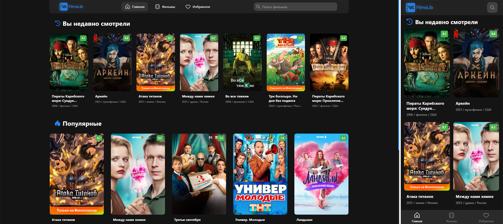
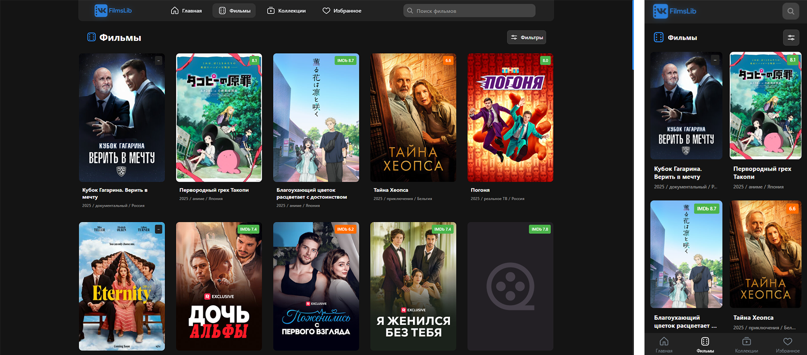
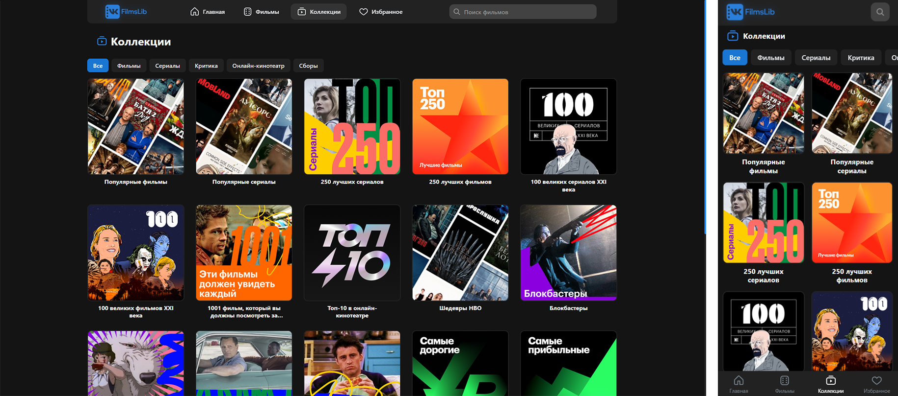
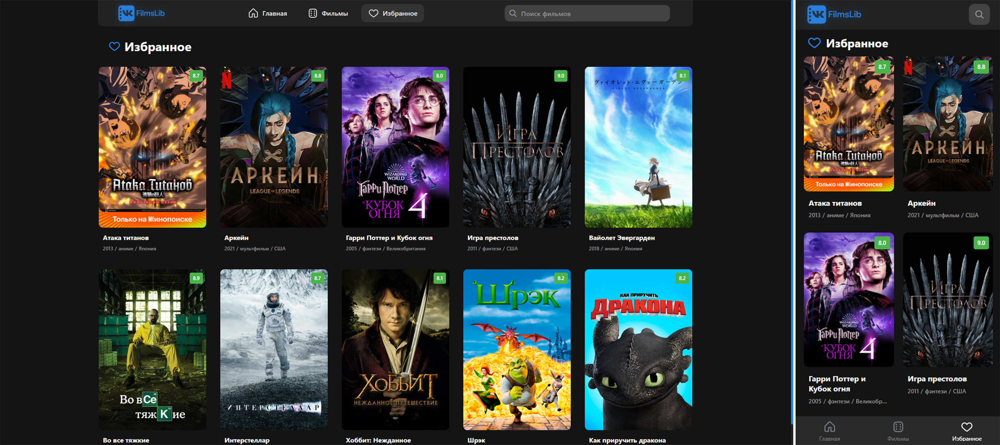
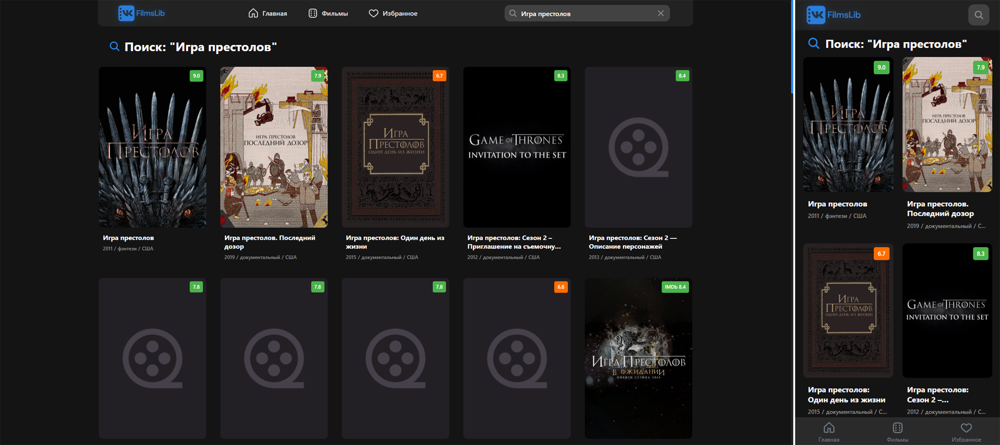
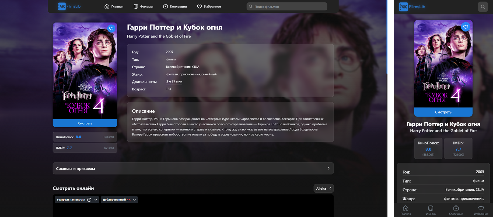
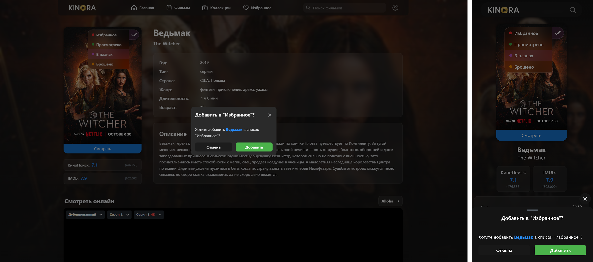
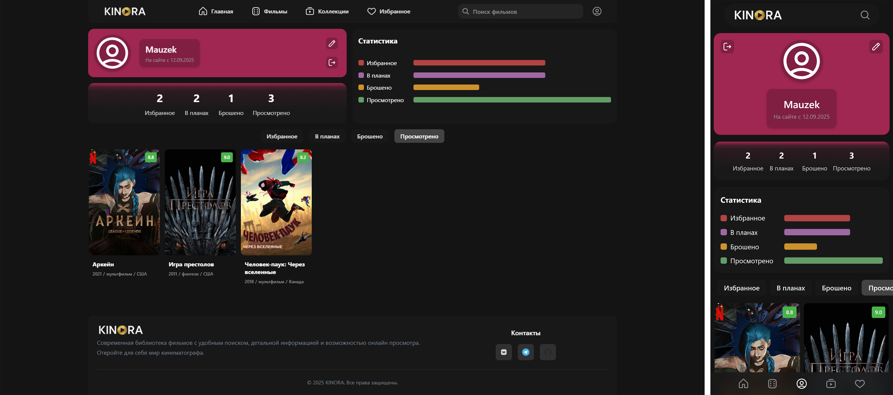
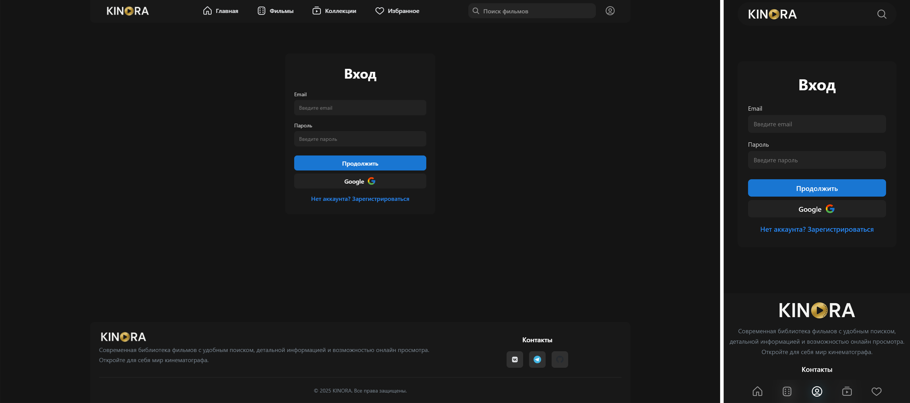

<div align="center">
  
</div>

**Современная библиотека фильмов с элегантным интерфейсом и мощным функционалом**

[**KINORA**](https://kinoraa.vercel.app/) — это веб-приложение для поиска, просмотра и изучения фильмов, построенное на современных технологиях с акцентом на производительность и пользовательский опыт.


## 📸 Скриншоты

<!-- Место для скриншотов -->
<div align="center">
  
### Главная страница


### Страница фильмов и фильтров


### Страница коллекций


### Избранное


### Поиск фильмов


### Страница фильма


### Добавление в личные списки


### Профиль


### Авторизация/Регистрация


</div>

---

## ✨ Основные возможности

### 👤 **Личный аккаунт**
- Доступно только авторизованным пользователям
- Профиль со статистикой
- Личные коллекции фильмов и сериалов

### 🔐 **Авторизация/Регистрация**
- Вход и регистрация по email и паролю
- Быстрая авторизация через Google

### 🔍 **Умный поиск**
- Быстрый поиск по названию фильма
- Поиск по альтернативным названиям

### 🎯 **Продвинутые фильтры**
- Фильтрация по жанрам и странам
- Диапазон рейтингов (КиноПоиск, IMDb)
- Фильтр по годам выпуска
- Сохранение выбранных фильтров в URL для шеринга и перезагрузки

### 📱 **Адаптивный дизайн**
- Полная поддержка мобильных устройств
- Реализована установка PWA-приложения
- Оптимизированный UX для сенсорных экранов

### 🎥 **Детальная информация о фильмах**
- Подробное описание и характеристики
- Рейтинги и списки рекомендованных фильмов
- Информация о сиквелах и приквелах
- Просмотр полных фильмов через защищённый видеоплеер (только после авторизации)

### 🔄 **Бесконечная прокрутка**
- Автоматическая подгрузка контента
- Оптимизированная производительность
- Плавная навигация

### 📚 **Коллекции и рекомендации**
- Готовые коллекции фильмов и сериалов
- Автоматическое сохранение истории просмотров
- Синхронизация данных между устройствами (через Firebase)
---

## 🛠 Технологический стек

### **Frontend**
- **React 18** — библиотека для создания декларативных пользовательских интерфейсов
- **TypeScript** — статическая типизация для повышения надёжности и поддержки кода
- **Vite** — современный сборщик с молниеносным dev-сервером и HMR
- **React Router** — клиентская маршрутизация и навигация

### **Управление состоянием**
- **MobX** — реактивное управление глобальным состоянием
- **MobX React Lite** — лёгкая интеграция MobX с React-компонентами

### **Стилизация**
- **SCSS/Sass** — расширение возможностей CSS через препроцессор
- **CSS Modules** — изоляция стилей на уровне компонентов
- **@vkontakte/icons** — официальный набор иконок от VK
- **GSAP** — высокопроизводительные анимации
- **Swiper** — реализация интерактивных каруселей и слайдеров

### **API и данные**
- **Axios** — HTTP-клиент для выполнения запросов к API
- **КиноПоиск API** — источник информации о фильмах, рейтингах и жанрах
- **Firebase (Firestore)** — облачная NoSQL-база данных для хранения пользовательских закладок и настроек

### **Дополнительные возможности**
- **Бесконечная прокрутка (Infinite Scroll)** — динамическая подгрузка контента при скролле
- **Синхронизация состояния с URL** — сохранение фильтров, поиска и пагинации в адресной строке для шеринга и перезагрузки

---

## 🚀 Быстрый старт

### Предварительные требования
- Node.js 18+ 
- npm или yarn

### Установка

```bash
# Клонирование репозитория
git clone https://github.com/Mauzek/FilmLibrary.git
cd FilmLibrary

# Установка зависимостей
npm install

# Запуск в режиме разработки
npm run dev
```

### Сборка для продакшена

```bash
# Создание production сборки
npm run build

# Предварительный просмотр сборки
npm run preview
```

---

## 📁 Структура проекта

```
src/
├── 📂 api/              # API клиенты и конфигурация
├── 📂 assets/           # Статические ресурсы
├── 📂 components/       # React компоненты
│   ├── 📂 form/         # Формы и элементы ввода
│   ├── 📂 layout/       # Компоненты макета (Header, Footer, TabBar и т.д)
│   ├── 📂 shared/       # Переиспользуемые компоненты
│   └── 📂 ui/           # UI компоненты
├── 📂 сonfig/           # Конфигурация приложения
├── 📂 data/             # Статические данные
├── 📂 hooks/            # Пользовательские хуки
├── 📂 pages/            # Страницы приложения
│   ├── 📂 Collection/   # Коллекция
│   ├── 📂 Collections/  # Список коллекции 
│   ├── 📂 Favoutire/    # Избранное
│   ├── 📂 Main/         # Главная страница
│   ├── 📂 Movies/       # Каталог фильмов
│   ├── 📂 Search/       # Поиск
│   ├── 📂 NotFound/     # Страница 404
│   ├── 📂 Profile/      # Профиль пользователя
│   ├── 📂 Auth/         # Авторизация/Регистрация
│   └── 📂 Movie/[id]/   # Детальная страница фильма
├── 📂 services/         # Сервисы для работы с базой даных (Firebase)
├── 📂 store/            # MobX стор
├── 📂 styles/           # Глобальные стили и переменные
├── 📂 types/            # TypeScript типы
└── 📂 utils/            # Утилиты и хелперы
```

---

## 🎨 Особенности дизайна

### **Темная тема**
- Современный темный интерфейс
- Высокий контраст для лучшей читаемости
- Плавные переходы и анимации

### **Адаптивность**
- Mobile-first подход
- Гибкая сетка и компоненты
- Оптимизация для всех устройств

### **Производительность**
- Ленивая загрузка изображений
- Виртуализация длинных списков
- Оптимизированные запросы к API

---

## 🔧 Конфигурация

### Переменные окружения

Создайте файл `.env.local`:

```env
VITE_API_URL=https://api.kinopoisk.dev/v1.4
VITE_API_TOKEN=xxxxxx-xxxxxx-xxxxxx-xxxxxxx
VITE_PLAYER_TOKEN=xxxxxxxxxxxxxxxxxxxxxxxxx
VITE_PLAYER_URL=https://xxxxxxxxxxxxxxxxxxx
VITE_PLAYERS_LIST_URL=https://xxxxxxxxxxxxx

VITE_FIREBASE_API_KEY=xxxxxxxxxxxxxxxxxxxxx
VITE_FIREBASE_AUTH_DOMAIN=xxxxxxxxxxxxxxxxx
VITE_FIREBASE_PROJECT_ID=xxxxxxxxxxxxxxxxxx
VITE_FIREBASE_STORAGE_BUCKET=xxxxxxxxxxxxxx
VITE_FIREBASE_MESSAGING_SENDER_ID=xxxxxxxxx
VITE_FIREBASE_APP_ID=xxxxxxxxxxxxxxxxxxxxxx
VITE_FIREBASE_MEASUREMENT_ID=xxxxxxxxxxxxxx
```

### Настройка API

Приложение использует API КиноПоиска. Для получения токена:
1. Перейдите на [kinopoisk.dev](https://kinopoisk.dev/)
2. Зарегистрируйтесь и получите API ключ
3. Добавьте ключ в переменные окружения

---


## 👨‍💻 Автор

**Mauzek**
- GitHub: [@Mauzek](https://github.com/Mauzek)
- Проект: [FilmLibrary](https://github.com/Mauzek/FilmLibrary)

---

<div align="center">

**⭐ Поставьте звезду, если проект вам понравился!**

[🐛 Сообщить об ошибке](https://github.com/Mauzek/FilmLibrary/issues) • [💡 Предложить улучшение](https://github.com/Mauzek/FilmLibrary/issues) • [📖 Документация](https://github.com/Mauzek/FilmLibrary/wiki)

</div>
